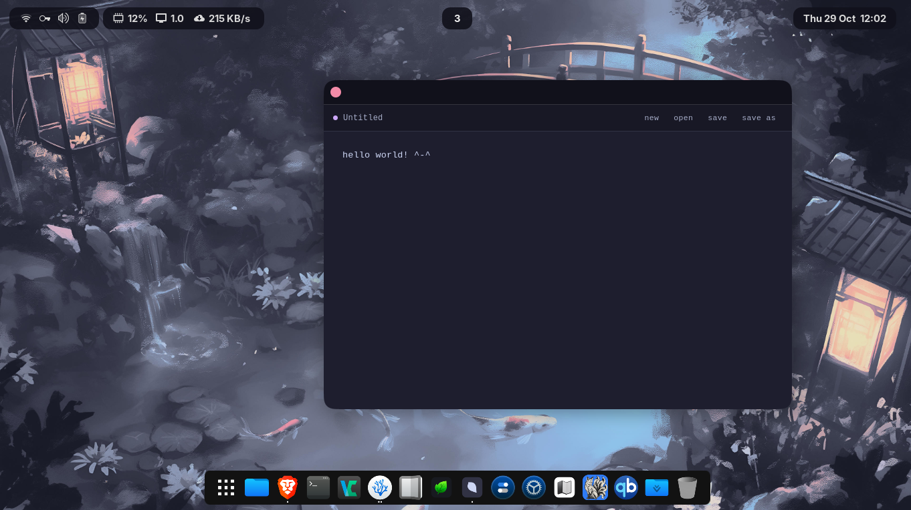

If you find Petal useful, consider [giving it a star ⭐](https://github.com/larrydarko1/petal) — it helps others discover the project!

Petal is a **minimal plain-text editor** for desktop built with **[Tauri 2](https://v2.tauri.app/)**, **Vue 3**, and TypeScript. Open, edit, and save `.txt` files — nothing more. No tabs, no plugins, no formatting, no bloat. Everything stays on your device: no cloud, no accounts, no tracking.

> **Prebuilt binaries are published for Linux only.** macOS and Windows build fine from source —
> see [Other platforms](#other-platforms) for why they aren't shipped and how to build your own.

# Demo



## Features

### Editing

- **New / Open / Save / Save As** — standard file operations through native OS dialogs
- **Keyboard shortcuts** — `Ctrl+N`, `Ctrl+O`, `Ctrl+S`, `Ctrl+Shift+S` (`⌘` on macOS)
- **Unsaved changes guard** — asks before a new file, an open, or closing the window throws your edits away
- **Opens from your file manager** — the deb and rpm packages register Petal for `.txt` files, so a double-click opens them

### Privacy & Storage

- **Fully offline** — the app makes no network requests at all
- **Plain text files** — your documents are `.txt` files wherever you save them; Petal keeps no copy, no database, no history
- **No tracking** — zero telemetry or data collection

### Design

- **Distraction-free** — one window, one document, a monospace editor and a four-button toolbar that doubles as the window's drag handle
- **Dark theme** — a [Catppuccin Mocha](https://catppuccin.com) palette, with the native dialogs and scrollbar matching it
- **Sized to your screen** — the window opens at a comfortable share of the monitor it starts on

## Security & Privacy

### Privacy Guarantees

- **No telemetry** — no usage data, analytics, or crash reports
- **No network requests** — the CSP admits nothing but Tauri's own IPC, so the webview couldn't reach the network if it tried
- **No accounts** — no sign-ups, logins, or user tracking of any kind
- **No auto-update** — nothing phones home to check for a new version

### Security Architecture

- **Strict CSP** — scripts, styles and fonts come from the app bundle alone
- **No HTML rendering** — a document is edited in a plain `<textarea>`, so its contents are only ever text
- **Least-privilege capability** — the one window may read and write a text file, open the file dialogs, and log; nothing that runs programs is granted
- **Path containment** — the webview can only reach files you picked in a dialog or opened through the OS
- **Enforced in CI** — the `tauri-security` and `tauri-commands` gates in [`larry.config.ts`](larry.config.ts) check all of the above on every push

### Reporting Security Issues

If you discover a security vulnerability, **do not open a public issue.** Email the maintainer at <hello@larrydarko.dev> — see [SECURITY.md](.github/SECURITY.md) for what to include and what is in scope.

## Data Storage

### Your Documents

Documents live only where you save them. Petal remembers nothing between launches — no recent files, no settings, no session.

### Logs

The one thing Petal writes on its own is a diagnostic log, rotated at 1 MB with a single backup. It records what failed, never what you wrote:

- **Linux:** `~/.local/share/dev.larrydarko.petal/logs/`
- **macOS** (self-built): `~/Library/Logs/dev.larrydarko.petal/`
- **Windows** (self-built): `%LOCALAPPDATA%\dev.larrydarko.petal\logs\`

## Getting Started

### Prerequisites

- [Node.js](https://nodejs.org/) (v24+ recommended) and npm
- [Rust](https://www.rust-lang.org/tools/install) (stable)
- The [Tauri system dependencies](https://v2.tauri.app/start/prerequisites/) for your OS. On Debian/Ubuntu:

```sh
sudo apt-get install libwebkit2gtk-4.1-dev build-essential libxdo-dev libssl-dev libayatana-appindicator3-dev librsvg2-dev patchelf
```

### Setup

1. **Clone the repository**

```sh
git clone https://github.com/larrydarko1/petal.git
cd petal
```

2. **Install dependencies**

```sh
npm install
```

3. **Run in development mode**

```sh
npm run dev
```

### Testing & Code Quality

```sh
# Run all unit tests
npm test

# Run tests in watch mode (re-runs on file changes)
npm run test:watch

# Lint source code
npm run lint

# Auto-fix lint issues
npm run lint:fix

# Check formatting
npm run format:check

# Auto-format source code
npm run format

# Lint styles
npm run stylelint

# Rust: format check, Clippy, tests
npm run rust:fmt
npm run rust:lint
npm run rust:test

# Run every gate CI runs, in one go
npm run ci:check
```

Tests live in `tests/`, mirroring `src/`. The standards ESLint cannot see — dead code, declaration order, duplication, the SCSS architecture, the CI pipeline itself and more — are checked by the gates in `larry.config.ts`. `npm run check` runs them all, and `npx larry check dead-code scss-standards` runs the ones named. Three are Tauri's: `tauri-security` reads the CSP and the capabilities, `tauri-commands` follows each command from Rust to the bridge, and `error-handling/tauri` covers failures on both sides. The order and code-style gates read the Rust too.

On every push and pull request, CI runs lint, format check, stylelint, type-check, tests with coverage, every gate (the audit among them), the webview build, and then the Rust checks — the release pipeline only triggers if CI passes.

### Building for Production

```sh
# Build for Linux — the platform this project releases
npm run tauri:build:linux

# Build for macOS or Windows — not released, self-build only (see Other platforms)
npm run tauri:build:mac
npm run tauri:build:win
```

The built installers land in `src-tauri/target/release/bundle/`:

- **Linux:** `.AppImage`, `.deb` and `.rpm` packages
- **macOS:** `.dmg` installer
- **Windows:** `.exe` NSIS installer

The release workflow also packs the Linux binary into a `.tar.gz`; Tauri has no tarball target, so
a local build doesn't make one. `tauri:build:mac` has to run on a Mac and `tauri:build:win` on Windows.

### Installing the App

From a [release](https://github.com/larrydarko1/petal/releases), or from your own build:

- **AppImage** — `chmod +x` the file, then run it
- **deb / rpm** — install with your package manager
- **tar.gz** — extract anywhere and run the `petal` binary inside; it needs the system WebKitGTK (`libwebkit2gtk-4.1`), which the deb and rpm pull in for you. See [From the tarball](#from-the-tarball) for one way to wire it into your desktop

#### From the tarball

The tarball is just the binary and the licence, so where it lives and how it shows up is yours to
decide. One way, kept entirely in your home folder:

```sh
mkdir -p ~/.local/opt/petal
tar -xf Petal_*_amd64.tar.gz -C ~/.local/opt/petal --strip-components=1

# Icon — the tarball doesn't ship one
curl -Lo ~/.local/opt/petal/icon.png \
  https://raw.githubusercontent.com/larrydarko1/petal/main/src-tauri/icons/128x128@2x.png

# Menu entry, and Petal offered for .txt files
mkdir -p ~/.local/share/applications
cat > ~/.local/share/applications/petal.desktop <<EOF
[Desktop Entry]
Type=Application
Name=Petal
Exec=$HOME/.local/opt/petal/petal %F
Icon=$HOME/.local/opt/petal/icon.png
Terminal=false
Categories=Utility;TextEditor;
MimeType=text/plain;
EOF
```

To remove it, delete `~/.local/opt/petal` and `~/.local/share/applications/petal.desktop`.

## Other platforms

Releases carry Linux packages only. Shipping macOS and Windows binaries properly means paying for
signing certificates — an Apple Developer ID and a Windows code-signing certificate — and without
them every download either warns people off or gets blocked outright: Gatekeeper calls an unsigned
app "damaged", SmartScreen hides the installer behind "More info". I'd rather not publish binaries
that make you fight your OS to open them. Linux doesn't gatekeep downloads that way, so that's
where releases go.

Building it yourself sidesteps all of that: an app you compiled on your own machine isn't a
download, so neither OS quarantines it and no signature is needed. Install the
[Tauri prerequisites](https://v2.tauri.app/start/prerequisites/) for your OS, then:

```sh
git clone https://github.com/larrydarko1/petal.git
cd petal && npm ci

npm run tauri:build:mac   # on a Mac — .dmg in src-tauri/target/release/bundle/dmg/
npm run tauri:build:win   # on Windows — .exe in src-tauri/target/release/bundle/nsis/
```

This is a solo project, and it's a matter of resources rather than intent — self-built platforms
are untested by the maintainer, and bug reports from them are fixed on a best-effort basis.

## Tech Stack

- **Desktop:** [Tauri 2](https://v2.tauri.app/) (Linux releases; macOS and Windows build from source)
- **Frontend:** [Vue 3](https://vuejs.org), TypeScript, SCSS
- **Backend:** Rust — the official fs, dialog and log plugins, and one command for files the OS opens
- **Build Tool:** [Vite](https://vitejs.dev)
- **Testing:** [Vitest](https://vitest.dev) + [Vue Test Utils](https://test-utils.vuejs.org)
- **Linting & Formatting:** [@larrydarko/lint-config](https://www.npmjs.com/package/@larrydarko/lint-config) — one shared package that bundles [ESLint](https://eslint.org) (flat config) + [typescript-eslint](https://typescript-eslint.io), [Prettier](https://prettier.io), [stylelint](https://stylelint.io/), [knip](https://knip.dev) and the CI gate scripts — plus Clippy and rustfmt for the Rust
- **Git Hooks:** [Husky](https://typicode.github.io/husky) + [lint-staged](https://github.com/lint-staged/lint-staged) + [commitlint](https://commitlint.js.org) (Conventional Commits), configured through the same package

## Project Structure

```
petal/
├── src/                        # Vue 3 webview
│   ├── bridge/                 # The only code that imports @tauri-apps/*
│   │   ├── commands.ts         # One typed function per Rust command
│   │   ├── dialogs.ts          # Confirm and error message boxes
│   │   ├── errors.ts           # ERROR_CODES and CommandResult
│   │   ├── events.ts           # One subscribe function per event Rust emits
│   │   ├── files.ts            # File pickers, read and write
│   │   ├── log.ts              # The webview's logger (same file as Rust's)
│   │   └── window.ts           # The unsaved-changes guard on close
│   ├── composables/
│   │   ├── useDocument.ts      # The open document and its file operations
│   │   └── useShortcuts.ts     # ⌘N, ⌘O, ⌘S, ⌘⇧S
│   ├── consts/
│   │   └── errorMessages.ts    # What the user reads for each error code
│   ├── styles/
│   │   ├── index.scss          # The global stylesheet, imported once by main.ts
│   │   ├── _variables.scss     # Tokens and the palette; injected into every SFC, emits nothing
│   │   ├── _theme.scss         # The palette as CSS custom properties
│   │   └── _base.scss          # Reset, document shell, scrollbar, reduced motion
│   ├── App.vue                 # The editor window
│   └── main.ts                 # Vue app entry point
├── src-tauri/                  # Tauri / Rust
│   ├── src/
│   │   ├── main.rs             # Calls petal_lib::run()
│   │   ├── lib.rs              # The builder: plugins, state, commands, files opened by the OS
│   │   ├── error.rs            # The Error every command returns, sent as a code
│   │   ├── logger.rs           # tauri-plugin-log, with structured fields
│   │   └── commands/file.rs    # take_pending_files
│   ├── capabilities/
│   │   └── main.json           # What the main window may call
│   ├── icons/                  # Only the icons a build reads; macOS derives its .icns from the PNGs
│   ├── build.rs                # The command allowlist
│   ├── Cargo.toml              # Rust dependencies and Clippy lints
│   └── tauri.conf.json         # Tauri configuration: CSP, Linux bundle targets
├── tests/                      # Vitest suites, mirroring src/
├── design/                     # Source design files: the app icon (PSD) and the README banner
├── .github/
│   ├── actions/node-setup/     # Node 24 + npm ci, shared by every Node job
│   ├── assets/                 # README banner and demo screenshot
│   ├── ISSUE_TEMPLATE/         # Bug report and feature request forms
│   ├── CONTRIBUTING.md
│   ├── SECURITY.md
│   ├── CODE_OF_CONDUCT.md
│   ├── FUNDING.yml             # GitHub Sponsors config
│   └── workflows/
│       ├── ci.yml              # CI pipeline (lint, type-check, test, build, Rust checks)
│       ├── pr-title.yml        # Conventional-commit check on PR titles
│       └── release.yml         # Linux release: tag, build, publish
├── .husky/                     # Git hooks (pre-commit, commit-msg)
├── eslint.config.js            # ESLint, from @larrydarko/lint-config
├── stylelint.config.js         # Stylelint, from @larrydarko/lint-config
├── knip.config.js              # What the dead-code gate treats as an entry point
├── larry.config.ts             # The standards gates and their options, from @larrydarko/lint-config
├── vite.config.ts              # Vite build configuration
├── vitest.config.ts            # Vitest test configuration
└── tsconfig.*.json             # TypeScript projects: app, node (tool configs), test
```

## Contributing

Petal is a solo portfolio project and isn't open to code contributions, but bug reports are welcome —
see [CONTRIBUTING.md](.github/CONTRIBUTING.md). Security issues go by email to
<hello@larrydarko.dev>, never a public issue — see [SECURITY.md](.github/SECURITY.md).

## License

This project is licensed under the [MIT License](LICENSE).

## Acknowledgments

- Built on [Tauri](https://tauri.app), which keeps a desktop app this small
- Colours from the [Catppuccin](https://catppuccin.com) Mocha palette
